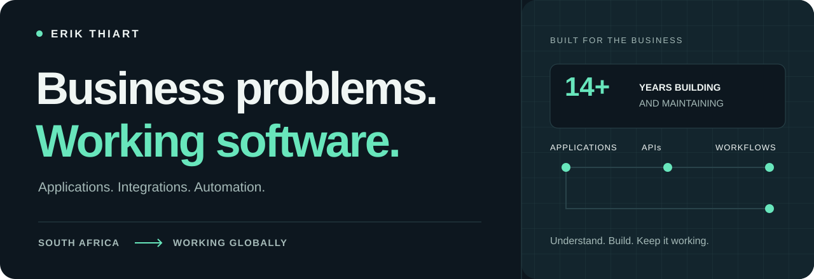
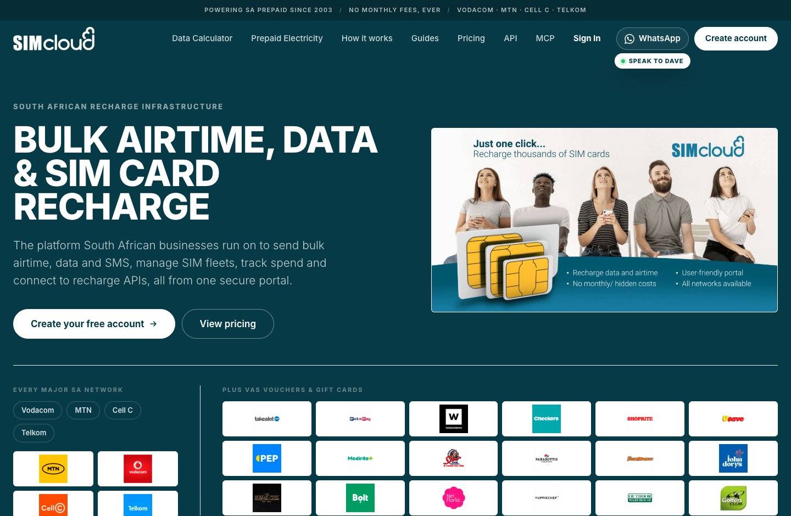
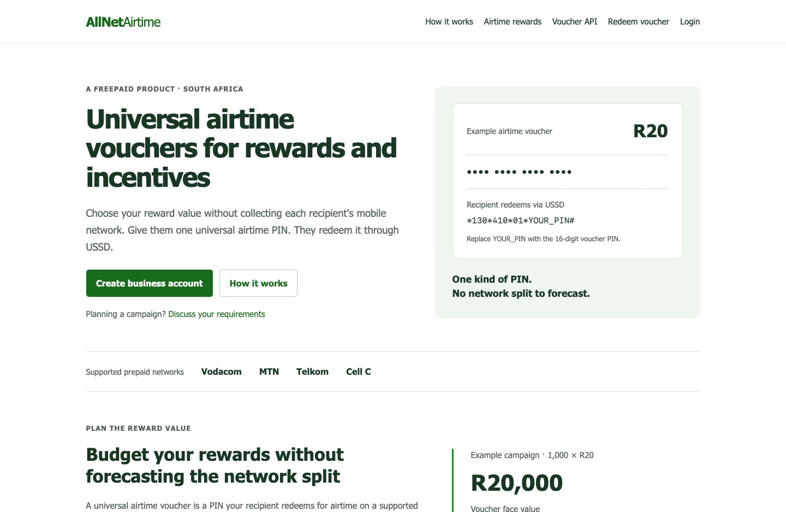
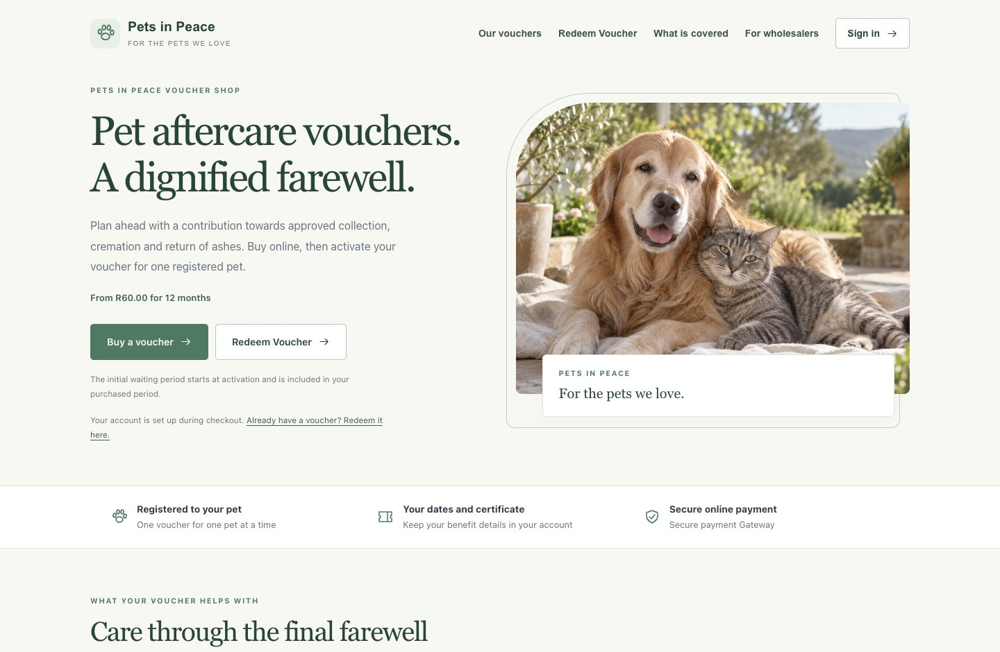
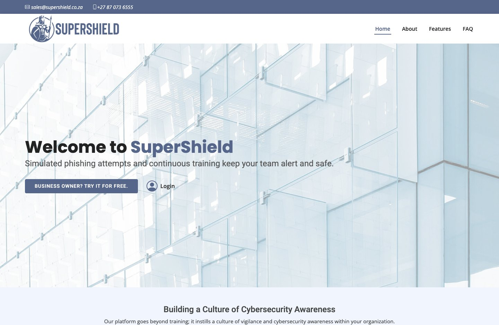
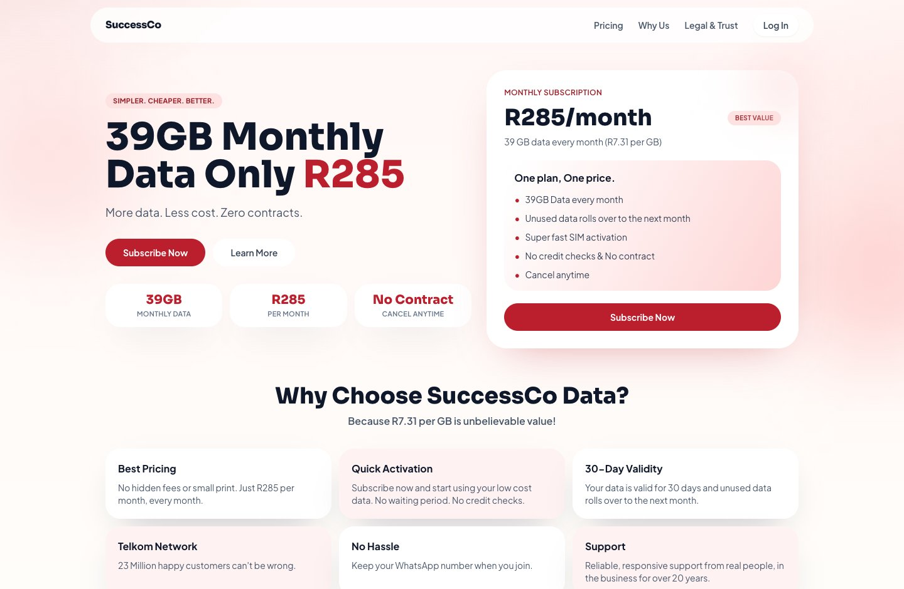
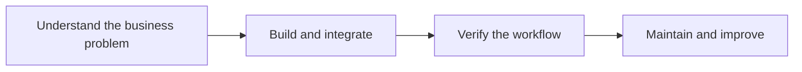

<picture>
  <source media="(prefers-color-scheme: dark)" srcset="assets/hero-dark.svg">
  <source media="(prefers-color-scheme: light)" srcset="assets/hero-light.svg">
  
</picture>

# Erik Thiart · Freelance Software Developer in South Africa

**I solve business problems with software.** I'm a full-stack developer based in South Africa, working with South African and international businesses. I have **14+ years of experience** building and maintaining applications, from the database and API to the interface people use every day.

PHP and MySQL are my main tools, but I'm not limited to that stack. I can work in any language the project needs. **The business problem comes first.**

  
  
  

> [!TIP]
> **Available for freelance projects, consulting and full-time software developer roles.** South Africa and international opportunities. Have a business problem to solve or need a Swiss Army knife on your team? I'm your guy. **[Get in touch →](mailto:web@erikthiart.com)**

[Selected projects](#selected-projects) &nbsp; / &nbsp; [Services](#freelance-software-development-services) &nbsp; / &nbsp; [Open source](#open-source-projects-and-integrations) &nbsp; / &nbsp; [Follow my work](#follow-the-work-behind-the-builds) &nbsp; / &nbsp; [Hire me](#lets-work-together)

| Experience | Work you can explore | Based in South Africa |
| :--- | :--- | :--- |
| **14+ years** building and maintaining software | **5 featured live websites and applications** | **Available internationally** for projects and team roles |

## Selected projects

### SIMcloud · Prepaid services and SIM fleet management

**The business need:** Recharge and manage a fleet of SIM cards from one place.

**What I built:** A prepaid services platform bringing together bulk airtime and data, prepaid electricity, business dashboards and API integrations. It connects the customer interface with the workflows behind prepaid delivery.

`Web application` `API integrations` `Business dashboards` `Automation`

**[Explore SIMcloud ↗](https://simcloud.co.za/)** · [Public API documentation](https://simcloud.co.za/api/index.html)

### More live websites and applications I've built

<table>
  <tr>
    <td width="50%" valign="top">
      
      <h3>AllNet Airtime</h3>
      
Universal airtime vouchers for customer promotions, survey incentives and staff rewards. Businesses can order and distribute vouchers through a dashboard or API without collecting each recipient's mobile network.

      
VOUCHER DISTRIBUTION · API ACCESS · BUSINESS REWARDS

      
<strong><a href="https://allnetairtime.co.za/">Explore AllNet Airtime ↗</a></strong>

    </td>
    <td width="50%" valign="top">
      
      <h3>Pets in Peace</h3>
      
A pet aftercare voucher platform where customers buy vouchers, register their pets and activate their vouchers. Online checkout, activation and customer accounts connect in one workflow.

      
ONLINE CHECKOUT · VOUCHER ACTIVATION · CUSTOMER PORTAL

      
<strong><a href="https://petsinpeaceshop.co.za/">Explore Pets in Peace ↗</a></strong>

    </td>
  </tr>
  <tr>
    <td width="50%" valign="top">
      
      <h3>SuperShield</h3>
      
A cybersecurity awareness and training platform that helps businesses train staff and track progress through assessments, phishing simulations and reporting dashboards.

      
STAFF TRAINING · ASSESSMENTS · REPORTING

      
<strong><a href="https://supershield.co.za/">Explore SuperShield ↗</a></strong>

    </td>
    <td width="50%" valign="top">
      
      <h3>SuccessCo</h3>
      
A mobile data subscription platform with monthly plan information, subscription signup and account access.

      
MOBILE DATA · SUBSCRIPTIONS · CUSTOMER ACCOUNTS

      
<strong><a href="https://successco125.co.za/">Explore SuccessCo ↗</a></strong>

    </td>
  </tr>
</table>

Previews show the public homepages. Follow each link to explore the current website.

## Freelance software development services

| What your business needs | How I can help |
| :--- | :--- |
| **A new application** | Custom web applications, customer portals and internal tools built around your workflow. |
| **Systems that work together** | API integration, data synchronisation and business automation. |
| **An existing PHP/MySQL application improved** | New features, database query improvements, maintenance and ongoing development. |
| **Useful admin tools** | Practical dashboards and interfaces with JavaScript, Bootstrap and AdminLTE. |
| **A problem investigated** | Debugging, slow-query investigation and failed-integration diagnosis, with clear logging and explicit error handling. |

My approach is straightforward: understand the problem, keep the solution as simple as it can be, and make it maintainable for the people who come after me.

<strong>How I approach a project</strong>

I can work directly with you on a defined project or join your existing team. I start with the current system, the outcome you need and the constraints that matter to your business.

## Open-source projects and integrations

| Project | What you can inspect | Status |
| :--- | :--- | :--- |
| **[SIMcloud for WooCommerce](https://github.com/ErikThiart/simcloud-woocommerce)** | WordPress/WooCommerce integration, background processing and a fulfilment ledger. | Installable prerelease |
| **[SIMcloud for Zoho Commerce](https://github.com/ErikThiart/simcloud-zoho-commerce)** | Product-import widget and procedural PHP connector with payment verification and reconciliation. | Developer alpha |
| **[DBease](https://github.com/ErikThiart/DBease)** | PHP/MySQL library using PDO, CRUD helpers, query logging and Composer installation. | Open source |
| **[Cryptocurrency Icons](https://github.com/ErikThiart/cryptocurrency-icons)** | An open-source cryptocurrency icon collection. | **250+ GitHub stars** |

<strong>Explore the commerce integration details</strong>

- **WooCommerce:** Connect eligible paid orders to the SIMcloud API, process them in the background and track each line through a fulfilment ledger. [Read the implementation and verification notes](https://github.com/ErikThiart/simcloud-woocommerce).
- **Zoho Commerce:** Import prepaid products through a widget and connect orders through procedural PHP, with payment verification and reconciliation for uncertain delivery outcomes. [Read the architecture and developer setup](https://github.com/ErikThiart/simcloud-zoho-commerce).

The repositories document their current prerelease/alpha status, testing evidence and remaining acceptance requirements.

## Follow the work behind the builds

Follow **[@ErikThiart on X](https://x.com/ErikThiart)** for the decisions behind the applications:

- **Practical development notes:** Turning business requirements into useful software.
- **API integration lessons:** Investigating failures, tracing requests and keeping workflows understandable.
- **Project updates:** What I'm building, the tradeoffs involved and what I learn along the way.

If you're a developer, founder or business owner, let's compare notes.

## Let's work together

Looking for a **freelance developer in South Africa**, an API integration specialist or a full-stack developer for your team? I'm available for **freelance, consulting and full-time work**, in South Africa and internationally.

For a project, tell me the business problem, your current software and the outcome you need, along with the scope and timeline you have in mind. For a full-time role, send me the role details and what your team is building.

**[Email web@erikthiart.com](mailto:web@erikthiart.com)** · [Connect on LinkedIn](https://www.linkedin.com/in/erikthiart/) · [Visit erikthiart.com](https://erikthiart.com/) · [Follow on X](https://x.com/ErikThiart)

---

<strong>Business problems. Working software.</strong> Erik Thiart · South Africa · Working internationally

